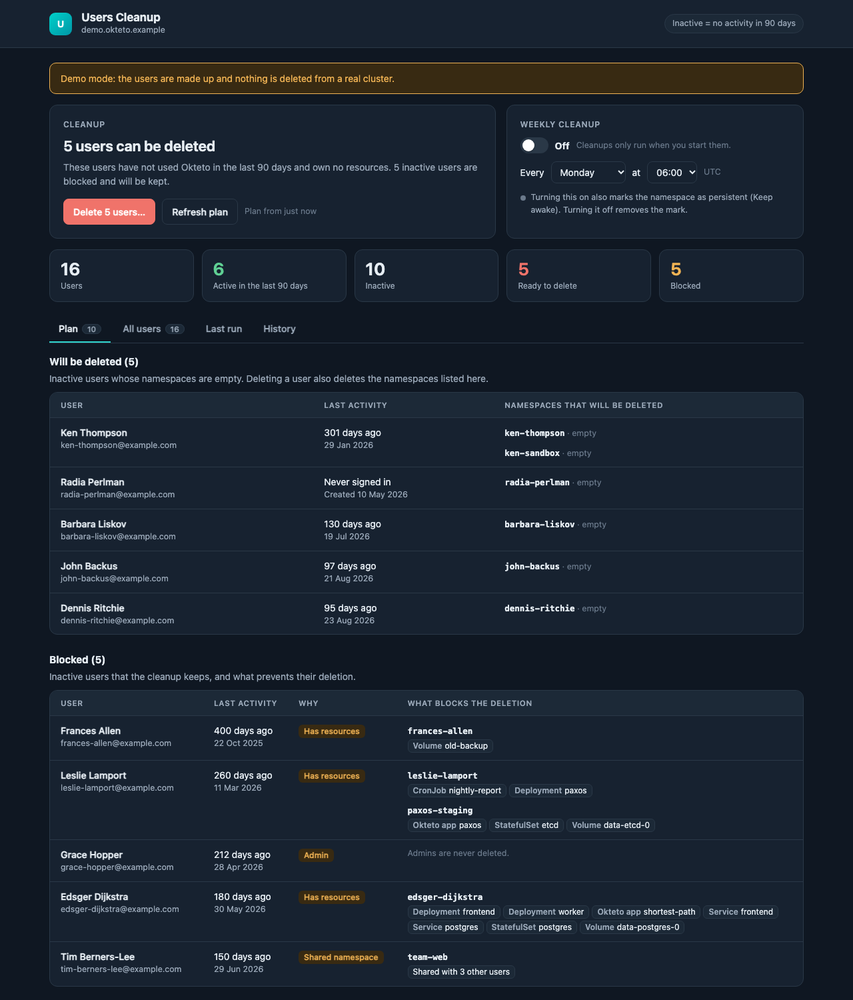
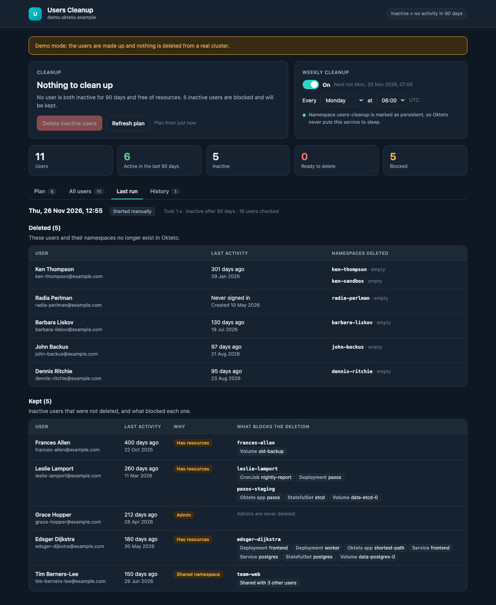
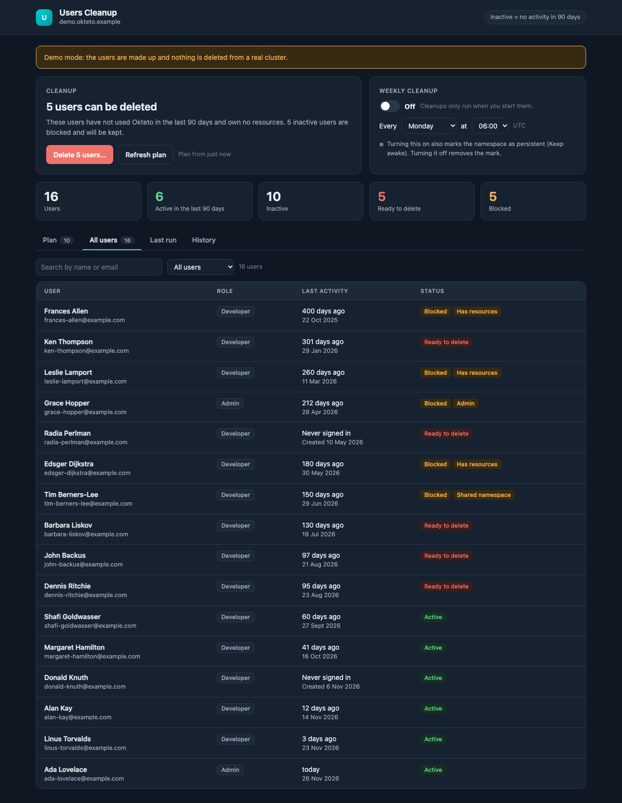

# Okteto Users Cleanup

A small service that finds the Okteto users without activity in the last 90 days and deletes the ones that are safe to delete. Deploy it with `okteto deploy` and you get a page to review the plan, run the cleanup and schedule it.

> This is an experiment and Okteto does not officially support it.



## What it does

- Shows every user with their last activity, and who is inactive
- Shows the plan of the cleanup: who will be deleted, who is kept, and what blocks each kept user
- Deletes the inactive users on demand, after a confirmation
- Runs the cleanup every week, if you turn the weekly schedule on
- Keeps a report of every run: users deleted, users kept and why, and deletions that failed

## How it works

1. **It lists the users.** The service asks the Okteto API for every user and their last activity, and separates the active users from the inactive ones.
2. **It inspects the inactive users.** For each of them, it reads from Kubernetes the namespaces they own, and what is inside each namespace.
3. **It makes a plan.** An inactive user with nothing to lose will be deleted. An inactive user who is an admin, has resources or shares a namespace is blocked, and the plan says why. The plan changes nothing: it is what you see when you open the page.
4. **You run the cleanup**, or the weekly schedule does. The run makes a fresh plan, checks every user once more, and deletes them through the Okteto API.
5. **It saves a report** of the run, with the users deleted, the users kept and the deletions that failed.

Active users are never inspected nor touched.

## Who gets deleted

A user is **inactive** when their last activity is older than `INACTIVE_DAYS` (90 by default). A user who never signed in counts from the day the account was created.

Deleting an Okteto user also deletes every namespace the user owns. For that reason, an inactive user is **kept** when any of these is true:

| Reason | Meaning |
|---|---|
| Admin | Admins are never deleted |
| Has resources | A namespace of the user has Okteto apps, Deployments, StatefulSets, DaemonSets, Jobs, CronJobs, Pods, volumes, Helm releases, Services or Ingresses |
| Shared namespace | A namespace of the user is shared with other users, who would lose it |
| No activity data | Okteto reports neither a last activity nor a creation date |
| Check failed | The namespaces of the user could not be inspected |

The plan and the report list the namespaces and resources that block each user, so you can clean them up or leave them.



The **All users** tab shows the last activity and the status of every user, active or not:



Every user is checked again right before being deleted. A run never deletes somebody who came back, or who got resources, after the plan was made.

## Requirements

**Deploy it in a namespace owned by an Okteto admin.** The service gets its credentials from Okteto, with the [`dev.okteto.com/inject-token`](https://www.okteto.com/docs/development/connect-your-ide/) annotation: the injected token acts as the owner of the namespace. With it, the service:

- lists and deletes users through the [Okteto API](https://www.okteto.com/docs/reference/okteto-api/)
- downloads the kubeconfig of the owner with `okteto kubeconfig`, to read the namespaces of each user and their resources
- marks its namespace as persistent when the weekly schedule is on

If the owner is not an admin, the page says so and nothing else works. There are no tokens to create or to configure.

Use a dedicated namespace: the owner of the namespace shows as active for as long as the service runs.

## Deploy

```bash
okteto namespace create users-cleanup
okteto deploy -n users-cleanup
```

When the deploy finishes, Okteto prints the URL of the page:

```
Endpoints available:
  - https://users-cleanup-users-cleanup.<your-okteto-domain>
```

You can also deploy it from the Okteto UI (**Deploy**, then select this repository) or add it to the Catalog (**Admin → Catalog**).

### Variables

| Variable | Default | Description |
|---|---|---|
| `INACTIVE_DAYS` | `90` | Days without activity after which a user is inactive |

```bash
okteto deploy -n users-cleanup --var INACTIVE_DAYS=180
```

## Weekly cleanup

The schedule is off by default: nothing is deleted until you ask for it. Turn it on in the page and choose the day and the hour (UTC).

Okteto can put an idle namespace to sleep, and a sleeping service would miss its run. Turning the schedule on marks the namespace of the service as persistent (**Keep awake**), and turning it off removes the mark. A namespace that was already persistent stays persistent.

If the service was down at the scheduled time, the run starts as soon as it is back.

## Access to the page

The page has a button that deletes users, so its endpoint is a [Private Endpoint](https://www.okteto.com/docs/application-environments/endpoints/private-endpoints/): only the Okteto users with access to the namespace can open it, after signing in.

- Do not share the namespace with users who must not run the cleanup.
- Private Endpoints do not work in Self-Hosted instances that use Gateway API. There, the endpoint is public: restrict access to it by other means before deploying.
- Private Endpoints only restrict access from outside the cluster.

## Try it on your machine

Demo mode runs the same page against made-up users, without any cluster:

```bash
cd app
DEMO=true go run .
```

Open http://localhost:8080. The screenshots of this page come from demo mode.

## Development

```bash
cd app
go test ./...
```

| Folder | Content |
|---|---|
| `app/cleanup` | Decides who is inactive and who can be deleted, and runs the deletion |
| `app/okteto` | Client of the Okteto API |
| `app/kube` | Reads namespaces and resources with the kubeconfig from Okteto |
| `app/service` | One operation at a time, the weekly schedule and the keep-awake mark |
| `app/store` | Schedule and run reports, as JSON files in a volume |
| `app/web` | The page and its JSON API |
| `app/demo` | The made-up cluster of demo mode |
